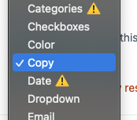
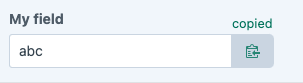

# Copy Field plugin for Craft CMS 5

A minimal click copy field for the Craft Control Panel.

Provides convenient "Click to Copy" input fields in Craft CP with single-click clipboard copying and visual feedback.

---

## Requirements

This plugin requires:
- **Craft CMS**: `^5.0.0`
- **PHP**: `^8.2 || ^8.3 || ^8.4 || ^8.5`

---

## Installation

### Composer
```bash
composer require leowebguy/copy-field -w && php craft plugin/install copy-field
```

### DDEV
```bash
ddev composer require leowebguy/copy-field -w && ddev exec php craft plugin/install copy-field
```

---

## Field Types

The plugin registers two custom field types:

1. **Copy**: Editable text field with a click-to-copy button.
2. **Copy (Readonly)**: Readonly text field preventing accidental edits while enabling one-click copying.

---

## Usage

### 1. Set field type
Add a new field under **Settings → Fields** and select either **Copy** or **Copy (Readonly)**:



### 2. Click and Copy
In the entry edit screen, click the clipboard icon to copy the input value directly to your clipboard:



---

## Development & Code Quality

Run static analysis and code formatting tools:

```bash
# Static analysis (PHPStan Level 8)
composer phpstan

# Code style testing (Laravel Pint / PSR-12)
composer pint-test

# Code style automatic fix
composer pint
```

---

### Need something?

PRs and issues are welcome at https://github.com/leowebguy/copy-field
